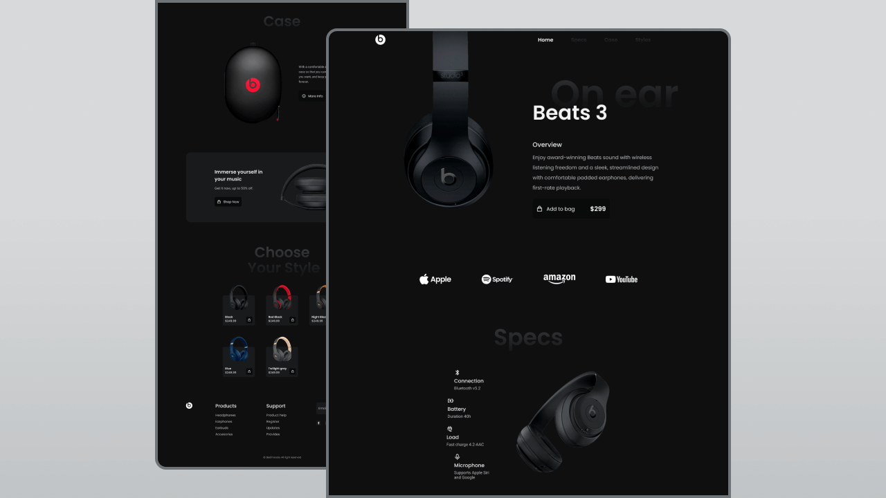

<div align="center">

# 🎧 Beats Audio — Premium Headphones E-Commerce Store

[](https://www.php.net/)
[](https://www.mysql.com/)
[](https://tailwindcss.com/)
[](https://developer.mozilla.org/en-US/docs/Web/JavaScript)
[](https://greensock.com/gsap/)

**A full-stack e-commerce platform for premium headphones — featuring user accounts, API-driven cart, multi-payment checkout, admin dashboard, and cinematic GSAP animations.**

[Live Demo →](#) · [Report Bug →](../../issues) · [Request Feature →](../../issues)



</div>

---

## ✨ Key Features

### Storefront
| Feature | Description |
|---------|-------------|
| 🎬 **GSAP Animations** | Cinematic hero timeline, scroll-triggered reveals, parallax effects, and 3D product card tilts |
| 🛒 **API-Driven Cart** | Server-side cart with session support for guests and persistent carts for logged-in users |
| 🎨 **Color Swatches** | Interactive color switching with smooth image transitions on hero and quick-view modal |
| 💳 **Multi-Payment Checkout** | Cash on Delivery, M-Pesa (Send Money), Bank Transfer, and PayPal |
| 📱 **Mobile-First Responsive** | Flawless experience from 320px phones to ultra-wide desktops |
| 🌊 **Lenis Smooth Scroll** | Butter-smooth scrolling synced with GSAP ScrollTrigger |
| 🔍 **Quick-View Modal** | Product details overlay with color switching and add-to-cart |
| 📬 **Contact & Newsletter** | Contact form with DB storage and newsletter subscription |

### User Dashboard
| Feature | Description |
|---------|-------------|
| 👤 **Authentication** | Register, login, logout, forgot password with secure session handling |
| 📦 **Order Tracking** | View orders with status history, item details, and order timeline |
| ❤️ **Wishlist** | Save favorite products, add to cart directly from wishlist |
| 📍 **Address Book** | Manage multiple shipping addresses with default selection |
| 🔐 **Profile Management** | Update name, email, phone, and change password |
| 🛒 **Cart Merge** | Guest cart items automatically merge when logging in |

### Admin Panel
| Feature | Description |
|---------|-------------|
| 📊 **Analytics Dashboard** | Revenue charts, order stats, and customer insights |
| 📦 **Product Management** | Add, edit, and manage products with images and pricing |
| 🛍️ **Order Management** | View, update status, and track all customer orders |
| 👥 **Customer Management** | View registered customers and their activity |
| 💰 **Payment Tracking** | Monitor payment statuses across all orders |
| ✉️ **Messages & Newsletter** | View contact form messages and manage newsletter subscribers |
| ⚙️ **Site Settings** | Configure store settings and notifications |

---

## 🛠️ Tech Stack

| Technology | Purpose |
|-----------|---------|
| **PHP 8+** | Backend logic, routing, authentication, API endpoints |
| **MySQL / MariaDB** | Relational database with PDO prepared statements |
| **Tailwind CSS** (CDN) | Utility-first styling with custom dark theme & neon accents |
| **Vanilla JavaScript** | Cart interactions, form handling, payment UI |
| **GSAP 3** + ScrollTrigger | Professional-grade scroll animations and timelines |
| **Lenis** | Smooth-scroll engine synced with GSAP ticker |
| **Remix Icons** | Lightweight icon set via CDN |
| **Inter + Space Grotesk** | Modern typography via Google Fonts |

---

## 🚀 Getting Started

### Prerequisites

- **XAMPP** (or any Apache + PHP 8+ + MySQL stack)
- **Git**

### Installation

```bash
# 1. Clone the repo into your web server directory
cd C:\xampp\htdocs
git clone https://github.com/WAIYAH/headphones1.duka.git
cd headphones1.duka

# 2. Create the database
#    Open phpMyAdmin (http://localhost/phpmyadmin)
#    Import sql/schema.sql — this creates the database, tables, and seed data

# 3. Configure environment
cp .env.example .env
#    Edit .env with your database credentials (default: root with no password)

# 4. Open in browser
#    http://localhost/headphones1.duka
```

### Default Configuration

| Setting | Value |
|---------|-------|
| Database | `headphones1_duka` |
| DB User | `root` |
| DB Password | *(empty)* |
| App URL | `http://localhost/headphones1.duka` |

---

## 📁 Project Structure

```
headphones1.duka/
├── index.php                # Landing page (hero, products, testimonials, FAQ)
├── shop.php                 # Product catalog with filtering
├── product.php              # Single product detail page
├── checkout.php             # Checkout with multi-payment options
├── contact.php              # Contact form
├── 404.php                  # Custom error page
│
├── api/                     # REST API endpoints
│   ├── cart.php             # Cart CRUD (add, update, remove, get)
│   ├── checkout.php         # Order placement
│   ├── contact.php          # Contact form submission
│   └── newsletter.php       # Newsletter subscription
│
├── auth/                    # Authentication
│   ├── login.php
│   ├── register.php
│   ├── logout.php
│   └── forgot-password.php
│
├── account/                 # User dashboard
│   ├── index.php            # Dashboard overview
│   ├── orders.php           # Order list with status tabs
│   ├── order-view.php       # Order detail with timeline
│   ├── wishlist.php         # Saved products
│   ├── addresses.php        # Address management
│   ├── profile.php          # Profile & password settings
│   └── includes/            # Dashboard layout (header/footer)
│
├── admin/                   # Admin panel
│   ├── index.php            # Analytics dashboard
│   ├── products.php         # Product management
│   ├── product-edit.php     # Product editor
│   ├── orders.php           # Order management
│   ├── order-view.php       # Order detail
│   ├── customers.php        # Customer list
│   ├── payments.php         # Payment tracking
│   ├── messages.php         # Contact messages
│   ├── newsletter.php       # Subscriber management
│   ├── settings.php         # Site configuration
│   └── includes/            # Admin layout (header/footer)
│
├── includes/                # Shared backend
│   ├── config.php           # Database connection, constants, session
│   ├── functions.php        # Helper functions (auth, cart, CSRF, etc.)
│   ├── header.php           # Main site header with cart drawer
│   ├── footer.php           # Main site footer
│   └── tailwind-config.php  # Tailwind CDN configuration
│
├── legal/                   # Legal pages
│   ├── privacy-policy.php
│   ├── terms-of-service.php
│   └── cookie-policy.php
│
├── assets/
│   ├── css/styles.css       # Custom styles (scrollbar, glassmorphism, etc.)
│   ├── js/main.js           # GSAP animations, Lenis, UI interactions
│   ├── js/cart.js           # API-driven cart module
│   └── img/                 # Product images, logos, icons
│
├── sql/schema.sql           # Database schema + seed data
├── .env                     # Environment configuration
├── .htaccess                # Apache URL rewriting
├── robots.txt               # Search engine directives
└── sitemap.xml              # SEO sitemap
```

---

## 🎨 Design System

| Token | Value | Usage |
|-------|-------|-------|
| `dark-950` | `#050507` | Page background |
| `dark-800` | `#141418` | Card backgrounds |
| `neon-blue` | `#00d4ff` | Primary accent, CTAs, links |
| `neon-purple` | `#a855f7` | Gradients, secondary accent |
| `neon-pink` | `#ec4899` | Hover states, badges |
| Font: **Space Grotesk** | 400–700 | Headings, display text |
| Font: **Inter** | 300–900 | Body text, UI elements |

---

## 💳 Payment Methods

| Method | Details |
|--------|---------|
| **Cash on Delivery** | Pay when you receive your order |
| **M-Pesa** | Send Money to **0715674828** |
| **Bank Transfer** | Direct bank payment with order reference |
| **PayPal** | Pay with PayPal account |

---

## 🔒 Security

- CSRF token protection on all forms and API endpoints
- Password hashing with `password_hash()` (bcrypt)
- PDO prepared statements (no SQL injection)
- Input sanitization and validation
- Session regeneration on login
- HTTP-only secure session cookies
- XSS protection via output escaping (`htmlspecialchars`)

---

## 🌐 Deployment

| Platform | How |
|----------|-----|
| **Shared Hosting** | Upload files, import `sql/schema.sql`, update `.env` |
| **VPS / DigitalOcean** | Install LAMP stack, clone repo, configure Apache vhost |
| **XAMPP (Local)** | Clone into `htdocs/`, import schema, configure `.env` |
| **Vercel (display demo)** | With XAMPP running, run `php scripts/export-static.php`, commit `static-site/`, import the repo in Vercel. Storefront only — cart runs in the browser, accounts/checkout disabled |

---

## 📄 License

Distributed under the **MIT License**. See [`LICENSE`](LICENSE) for details.

---

## 🙏 Credits

- **Original landing page concept** by [Bedimcode](https://www.youtube.com/c/Bedimcode)
- **Full-stack e-commerce build** by **NAKOLA** — complete PHP backend, database architecture, user dashboard, admin panel, API-driven cart, multi-payment checkout, and premium dark theme

---

<div align="center">

Made with ❤️ in Nairobi by **NAKOLA**

⭐ Star this repo if you found it useful!

</div>
